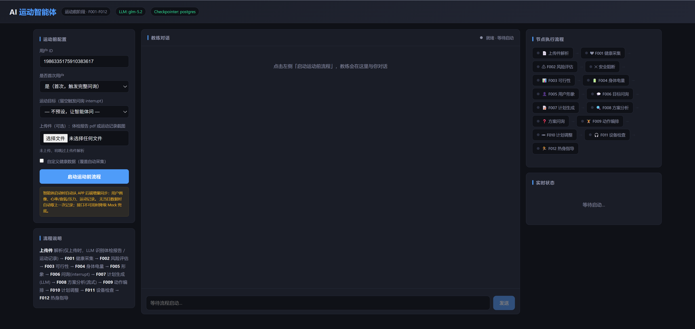

# PreFit AI（启跃智伴）

## 项目简介

**PreFit AI（启跃智伴）** —— 基于 LangGraph 的运动前健康评估与智能规划服务。

以智能耳机/APP 为入口，融合生理传感数据、用户画像、运动历史与环境数据，通过 LLM 决策在运动开始前的 0–10 分钟内完成：健康评估 → 风险预警 → 可行性分析 → 体能基线测定 → 目标问询 → 运动计划生成 → 方案编排 → 设备检查 → 热身指导。

> 当前版本聚焦**运动前阶段**，不包含运动中实时干预与运动后恢复分析。



## 功能范围（运动前 0–10 分钟）

| 编号    | 功能模块       | 说明                                                   |
|---------|--------------|------------------------------------------------------|
| F001    | 基础健康状态采集  | 自动抓取静息心率、血氧、HRV、压力值，评估当日基础健康状态                |
| F002    | 生理风险预警初筛  | 规则引擎判定高风险运动禁忌（心率过高/血氧过低），结合医学 RAG 给出建议      |
| F003    | 运动可行性评估   | 综合生理数据与健康档案，输出风险等级（低/中/高）及运动建议                  |
| F004    | 体能状态基线测定  | 基于静息心率、HRV、恢复疲劳等建立身体电量基线（佳明算法）                   |
| F005    | 用户形象模拟    | 根据用户数据绘制基本形象与运动风格（随 BMI 变化）                       |
| F006    | 运动目的问询    | 主动问询运动目的/习惯/可接受强度，支持打断与跳过（interrupt 恢复）             |
| F007    | 个性化运动方案生成 | 依据体能基线、运动目标、可用时间生成个性化运动计划                       |
| F008    | 运动方案综合分析  | 结合历史运动、当日健康、天气、恢复状态流式推荐强度与时长                     |
| F009    | 方案智能编排    | 根据运动类型与身体状态自动生成热身、主运动、拉伸方案                       |
| F010    | 方案详情及变更   | 支持语音/按键查看方案详情与调整强度                                   |
| F011    | 设备状态检查    | 自动检查耳机电量、蓝牙连接、传感器校准状态                             |
| F012    | 热身指导      | 语音引导针对性热身动作                                              |
| 附加      | 体检报告上传解析  | 用户可上传 PDF 体检报告，自动分析并更新用户画像，用于后续计划生成（v1.0.0）       |

## 技术架构

| 层级   | 选型                                                      | 作用                          |
|------|---------------------------------------------------------|-----------------------------|
| 编排层  | LangGraph                                               | 状态化、分阶段、带风险阻断的决策流程引擎       |
| 能力层  | LangChain / langchain-openai                           | 工具调用、知识库访问、上下文管理               |
| 可观测  | LangSmith                                               | 调试、评估、监控智能体运行                  |
| 服务层  | FastAPI + uvicorn                                       | 暴露启动/恢复/流式执行/报告上传/健康检查端点       |
| 持久化  | PostgreSQL（落盘）/ SQLite checkpointer（默认开发）+ Redis       | 7 天基线校准、长期记忆、interrupt 恢复          |
| 向量库  | pgvector                                                | 医学知识 RAG、长期记忆检索                |
| 长期记忆  | Mem0                                                    | 用户画像与偏好沉淀                       |
| 报告解析  | pypdf                                                   | 体检报告 PDF 文本提取                  |

## 主流程

```
START
  ↓
memory_load（Mem0 记忆快照）
  ↓ ← 是否上传体检报告
  ├─ 上传 → report_analyze（解析 PDF + 更新画像）┐
  └─ 未上传 ──────────────────────────────────┤
                                             ↓
health_collect (F001) → risk_assess (F002)
  ↓ ← 风险等级
  ├─ high/forbidden → safety_stop → memory_write → END
  └─ low/mid
        ↓
feasibility (F003) → recovery (F004) → avatar (F005)
        ↓ ← 新老用户分流
        ├─ 新用户 → interview (F006, interrupt) ┐
        └─ 老用户 ────────────────────────────┤
                                             ↓
plan_generate (F007) → plan_analyze (F008) → plan_compose (F009) → plan_edit (F010)
        ↓
device_check (F011) → warmup (F012)
        ↓
memory_write（记忆沉淀，后台不阻塞）→ END
```

## 目录结构

```
prefit-ai/
├── src/sport_agent/
│   ├── graph.py            # LangGraph 图组装与编译
│   ├── state.py            # 状态定义
│   ├── config.py           # 配置（Postgres/Redis/向量库/checkpointer）
│   ├── main.py             # 入口
│   ├── nodes/              # 各功能节点（health/risk/recovery/plan/warmup ...）
│   ├── agents/             # Agent 提示词与结构化输出 schema
│   ├── algorithms/         # 确定性算法（body_battery 身体电量）
│   ├── tools/              # 工具层（health_api/report_tools/rag_tools/device_tools ...）
│   ├── db/                 # 数据访问（connection/training_history/health_metrics/user_state）
│   ├── memory/            # Mem0 长期记忆客户端
│   ├── eval/               # LangSmith 评估数据集与评估器
│   ├── api/server.py       # FastAPI 服务端点
│   └── utils/              # llm/logging/profile/timing
├── tests/                  # 测试
├── docs/                    # 设计与需求文档（见下方索引）
├── pyproject.toml
└── .env.example            # 环境变量模板
```

## 快速开始

### 1. 安装依赖

```bash
cd prefit-ai
python -m venv .venv && . .venv/bin/activate
pip install -e ".[dev]"          # 基础 + 开发工具
# 按需安装可选依赖
pip install -e ".[postgres]"    # PostgresSaver 落盘
pip install -e ".[vector]"      # pgvector 医学 RAG
pip install -e ".[memory]"      # Mem0 长期记忆
```

### 2. 配置环境变量

仓库提供 `.env.example` 作为配置模板（已被 `.gitignore` 显式保留 `!.env.example`，会随仓库分发）。克隆后复制为本地 `.env`（`.env` 本身被忽略，不入库）：

```bash
cp .env.example .env
# 编辑 .env 填写实际值
```

配置项说明：

| 分类 | 变量 | 是否必填 | 说明 |
|------|------|---------|------|
| LLM | `LLM_API_KEY` | 必填 | 兼容 OpenAI 协议的模型服务密钥（OpenAI/DeepSeek/Qwen 等） |
| LLM | `LLM_BASE_URL` | 必填 | 模型服务地址，如 `https://api.openai.com/v1` |
| LLM | `LLM_MODEL` | 必填 | 模型名，如 `gpt-4o-mini` |
| LLM | `LLM_TEMPERATURE` / `LLM_REQUEST_TIMEOUT` | 可选 | 生成温度与超时（默认 0.3 / 30s） |
| 可观测 | `LANGSMITH_API_KEY` | 可选 | LangSmith tracing 接入密钥 |
| 可观测 | `LANGSMITH_PROJECT` / `LANGCHAIN_TRACING_V2` | 可选 | 项目名与开关（建议开发期开启） |
| 服务 | `AGENT_SERVICE_HOST` / `AGENT_SERVICE_PORT` | 可选 | 服务监听地址（默认 0.0.0.0:8000，demo 用 8100） |
| 服务 | `LOG_LEVEL` | 可选 | 日志级别（默认 INFO） |
| 数据存储 | `POSTGRES_URL` | 可选 | 留空走 SQLite checkpointer；填写则切 PostgresSaver 落盘 |
| 数据存储 | `REDIS_URL` | 可选 | Session Memory / 短期对话缓存 |
| 数据存储 | `VECTOR_DB_URL` | 可选 | 向量库（医学知识 RAG / 动作库） |
| 外部接口 | `HEALTH_DATA_API_BASE` | 可选 | 健康数据 API，留空走 Mock |
| 外部接口 | `WEATHER_API_BASE` / `WEATHER_API_KEY` | 可选 | 天气数据，留空走 Mock |

> 骨架阶段（阶段 1）数据存储与外部接口均可留空，使用内存/checkpoint sqlite 与 Mock，保证流程可跑通。接入真实业务逻辑时再填写对应 URL/Key。

### 3. 运行服务

前台运行（调试用，终端关闭即停止）：

```bash
.venv/bin/python -m uvicorn sport_agent.api.server:app --host 0.0.0.0 --port 8100
```

后台运行（生产/长驻，终端关闭不停止）：

```bash
nohup .venv/bin/python -m uvicorn sport_agent.api.server:app --host 0.0.0.0 --port 8100 >> server.log 2>&1 &
echo $! > server.pid   # 记录进程号
```

查看日志：`tail -f server.log`
停止服务：`kill $(cat server.pid)`
重启服务：`kill $(cat server.pid); nohup .venv/bin/python -m uvicorn sport_agent.api.server:app --host 0.0.0.0 --port 8100 >> server.log 2>&1 & echo $! > server.pid`

## 技术设计参考

公开技术设计见根目录 [TECH_DESIGN.md](TECH_DESIGN.md)，整合了系统架构、技术栈选型理由、State 设计、主流程、关键设计决策与落地优先级。

> `docs/` 目录为内部资料（需求清单、技术设计、接口文档、真实体检报告等），已加入 `.gitignore` 不随仓库分发。如需了解对外公开的架构与设计，请阅读 [TECH_DESIGN.md](TECH_DESIGN.md)。

## 下一阶段建议（阶段 2 - P0 业务逻辑）

骨架已就位，后续按 P0 优先级填充真实逻辑：

1. F002 风险规则 接入医学知识库 RAG（LangChain Retriever + pgvector）
2. F001 健康采集 接入真实耳机 PPG / 健康数据 API
3. F004 身体电量 接入佳明算法或精校模型
4. F007 计划生成 用 LLM + 结构化输出（ with_structured_output ）*
5. F008 方案分析 用 astream_events 实现真流式*
6. 切换 PostgresSaver 落盘，支撑 7 天基线校准与长期记忆*
7. 建 LangSmith 评估数据集（风险识别 10000 组标注）*
